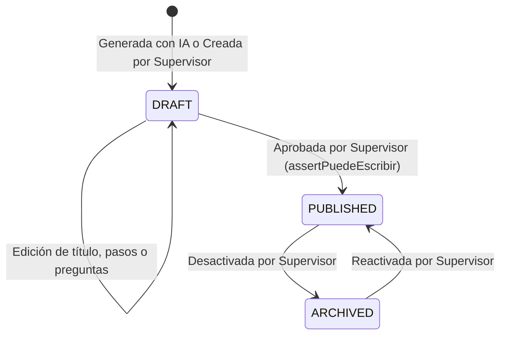

# Data Model: Estructura de capacitación y generación de píldoras

**Feature**: `014-estructura-y-generacion-de-pildoras`
**Fecha**: 2026-10-04

---

## 1. Extensiones al Esquema Prisma (`schema.prisma`)

```prisma
// --- Enums ---

enum PillStatus {
  DRAFT      // Borrador generado por IA o creado a mano; invisible para empleados
  PUBLISHED  // Publicado por el supervisor; visible para empleados del sector
  ARCHIVED   // Retirado del plan activo; mantiene historial de avance
}

enum TrainingProgressStatus {
  NOT_STARTED  // Aún no leída ni respondida
  IN_PROGRESS  // Leída o con intentos fallidos
  COMPLETED    // Preguntas de verificación aprobadas satisfactoriamente
}

// --- Modelos ---

model TrainingModule {
  id          String   @id @default(uuid())
  title       String
  description String?
  sectorId    String?  // Si es null, es un módulo transversal (GENERAL) para toda la empresa
  orderIndex  Int      @default(0)
  isActive    Boolean  @default(true)
  createdAt   DateTime @default(now())
  updatedAt   DateTime @updatedAt

  sector Sector? @relation(fields: [sectorId], references: [id])
  pills  Pill[]

  @@map("training_modules")
}

model Pill {
  id          String     @id @default(uuid())
  moduleId    String
  title       String
  objective   String
  content     String     @db.Text // Texto estructurado con los pasos operativos (Markdown)
  quiz        Json       // Array de exactamente 2 preguntas de autoevaluación
  status      PillStatus @default(DRAFT)
  orderIndex  Int        @default(0)

  createdById   String?
  publishedById String?
  publishedAt   DateTime?
  createdAt     DateTime   @default(now())
  updatedAt     DateTime   @updatedAt

  module      TrainingModule     @relation(fields: [moduleId], references: [id], onDelete: Cascade)
  createdBy   Employee?          @relation("PillCreatedBy", fields: [createdById], references: [id])
  publishedBy Employee?          @relation("PillPublishedBy", fields: [publishedById], references: [id])
  progress    EmployeeProgress[]

  @@map("pills")
}

model EmployeeProgress {
  id          String                 @id @default(uuid())
  employeeId  String
  pillId      String
  status      TrainingProgressStatus @default(NOT_STARTED)
  attempts    Int                    @default(0)
  lastAnswers Json?                  // Guarda las últimas respuestas enviadas [0, 1]
  completedAt DateTime?
  createdAt   DateTime               @default(now())
  updatedAt   DateTime               @updatedAt

  employee Employee @relation(fields: [employeeId], references: [id], onDelete: Cascade)
  pill     Pill     @relation(fields: [pillId], references: [id], onDelete: Cascade)

  @@unique([employeeId, pillId])
  @@map("employee_progress")
}
```

---

## 2. Estructura JSON del campo `quiz` en `Pill`

Cada elemento del arreglo contiene los siguientes campos validados:

```typescript
export interface VerificationQuestion {
  id: number;                // 1 o 2
  question: string;          // Enunciado claro y contextualizado al procedimiento
  options: string[];         // De 3 a 4 opciones plausibles
  correctOptionIndex: number;// Índice (0..3) de la opción correcta
  explanation: string;       // Justificación didáctica que se muestra al responder
}
```

---

## 3. Máquina de Estados del Ciclo de Vida de una Píldora



### Reglas de Transición:
1. `DRAFT`: Creada inicialmente. Solo supervisores autorizados para el sector (`Sector.agentType`) pueden verla o modificarla.
2. `PUBLISHED`: Pasa a ser visible para empleados asignados al sector del módulo (o todos si `sectorId == null`). Se estampa `publishedById` y `publishedAt`.
3. `ARCHIVED`: Ya no se lista a nuevos empleados, pero se preservan los registros históricos en `EmployeeProgress`.

---

## 4. Reglas de Desbloqueo y Avance (`EmployeeProgress`)

1. **Píldora inicial (orden 0)**: Desbloqueada por defecto si el módulo está activo.
2. **Píldoras subsiguientes (orden $k$)**: Desbloqueada únicamente si existe un registro de progreso para la píldora $k-1$ con `status === 'COMPLETED'`.
3. **Completitud**: Se alcanza al enviar `POST /training/pills/:id/verify` y acertar el 100% de las preguntas (`answers[i] === quiz[i].correctOptionIndex`). Se registra `completedAt = now()` y `status = 'COMPLETED'`.
