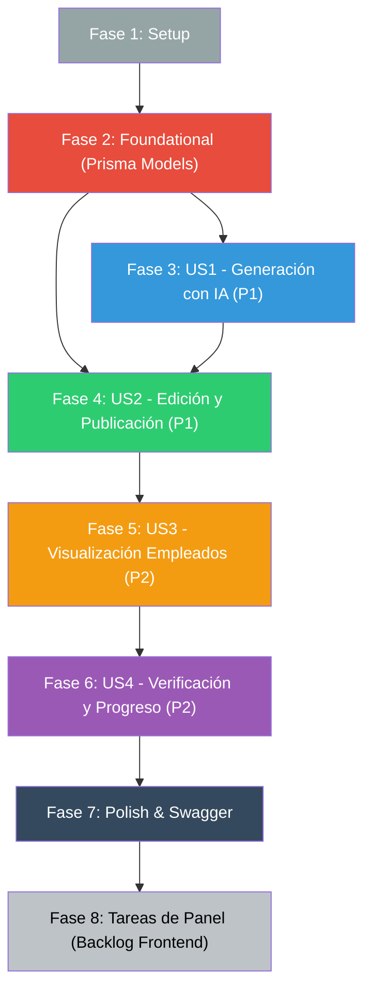

# Tasks: Estructura de capacitación y generación de píldoras

**Input**: Documentos de diseño en `specs/014-estructura-y-generacion-de-pildoras/`
**Prerequisites**: [plan.md](./plan.md), [spec.md](./spec.md), [research.md](./research.md), [data-model.md](./data-model.md), [contracts/training-api.yaml](./contracts/training-api.yaml), [quickstart.md](./quickstart.md)

**Tests**: Incluidos. La especificación toca gobernanza de contenido, roles por sector y generación con IA; los tests unitarios e integrados son obligatorios antes de cerrar cada fase (Principio V y CLAUDE.md).

## Format: `[ID] [P?] [Story] Descripción con ruta de archivo`

- **[P]**: Puede ejecutarse en paralelo (archivos distintos, sin dependencias pendientes).
- **[US#]**: A qué historia de usuario pertenece (obligatorio en fases de historias).

## Path Conventions

Backend NestJS en `src/`, schema en `prisma/`, tests `*.spec.ts` junto al código.
Tareas de frontend al final corresponden al repositorio hermano `trimIA-frontend`.

---

## Phase 1: Setup — Configuración y Línea Base

**Purpose**: Verificar el entorno de desarrollo, modelos existentes y base de datos antes de introducir cambios.

- [ ] T001 Verificar estado del entorno Docker (`docker compose ps`) y conexión activa a PostgreSQL y Redis
- [ ] T002 Confirmar existencia de usuarios de prueba en `prisma/seed.ts`: Silvia Ríos (Cobranzas), Diego Bazán (todas las áreas) y empleados asignados a sectores
- [ ] T003 Ejecutar suite de pruebas de regresión base (`npm test`) y registrar que los tests previos pasan en verde

---

## Phase 2: Foundational — Modelos de Datos y Migración

**Purpose**: Establecer las entidades de persistencia en Prisma y DTOs comunes que bloquean a todas las historias de usuario.

**⚠️ CRÍTICO: Ninguna historia de usuario puede implementarse hasta completar esta fase.**

- [ ] T004 Agregar enums `PillStatus` (`DRAFT`, `PUBLISHED`, `ARCHIVED`) y `TrainingProgressStatus` (`NOT_STARTED`, `IN_PROGRESS`, `COMPLETED`) en `prisma/schema.prisma`
- [ ] T005 Agregar modelo `TrainingModule` con campos `id`, `title`, `description`, `sectorId` (opcional), `orderIndex`, `isActive` y timestamps en `prisma/schema.prisma`
- [ ] T006 Agregar modelo `Pill` con campos `id`, `moduleId`, `title`, `objective`, `content` (Text), `quiz` (Json), `status` (PillStatus default DRAFT), `orderIndex`, `createdById`, `publishedById`, `publishedAt` y timestamps en `prisma/schema.prisma`
- [ ] T007 Agregar modelo `EmployeeProgress` con `@unique([employeeId, pillId])`, `status`, `attempts`, `lastAnswers` (Json) y `completedAt` en `prisma/schema.prisma`
- [ ] T008 Ejecutar `npx prisma db push` para aplicar los modelos a la base de datos de desarrollo
- [ ] T009 [P] Crear interfaces y DTOs compartidos en `src/training/dto/training-common.dto.ts` con la estructura estricta de `VerificationQuestion` (id, question, options, correctOptionIndex, explanation)
- [ ] T010 [P] Crear el módulo `TrainingModule` en `src/training/training.module.ts` e importarlo en `src/app.module.ts`

**Checkpoint**: Base de datos sincronizada y módulo base registrado.

---

## Phase 3: User Story 1 — Generación Asistida de Píldoras con IA (P1) 🎯 MVP (Parte 1)

**Goal**: Permitir al supervisor solicitar una píldora sobre un tema, consultar el RAG y entrevistas del sector, y generar una propuesta estructurada en `DRAFT` mediante Gemini.

**Independent Test**: Invocar el generador indicando un tema y sector; comprobar que retorna una propuesta completa con título, objetivo, pasos y 2 preguntas en estado `DRAFT`, inaccesible para empleados.

- [ ] T011 [US1] Crear `src/training/dto/generate-pill.dto.ts` con validaciones de `moduleId`, `topic` y `additionalNotes`
- [ ] T012 [US1] Implementar `TrainingGeneratorService` en `src/training/training-generator.service.ts` con consulta de contexto a `KnowledgeService.search()` (audiencia `INTERNO`, k=4)
- [ ] T013 [US1] En `TrainingGeneratorService`, incorporar recuperación de respuestas de entrevistas del sector desde `InterviewSession` como contexto complementario
- [ ] T014 [US1] Configurar la llamada a Gemini con Schema Structured Output en `TrainingGeneratorService` exigiendo: título, objetivo, pasos 1..N y exactamente 2 preguntas con explicaciones (SC-003)
- [ ] T015 [US1] Implementar manejo de contexto RAG insuficiente en `TrainingGeneratorService` para abortar limpiamente en lugar de alucinar (Principio II)
- [ ] T016 [US1] En `TrainingService` (`src/training/training.service.ts`), implementar `generatePillDraft()` que persista la píldora generada en estado `DRAFT` con `createdById = user.id`
- [ ] T017 [US1] Crear pruebas unitarias en `src/training/training-generator.service.spec.ts` para verificar la generación estructurada, el formateo y el manejo de contexto ausente

**Checkpoint**: La generación asistida produce píldoras estructuradas en borrador.

---

## Phase 4: User Story 2 — Revisión, Edición y Publicación con Gobernanza (P1) 🎯 MVP (Parte 2)

**Goal**: Permitir al supervisor revisar la píldora en borrador, editarla manualmente, aprobarla/publicarla para su sector respetando `assertPuedeEscribir`, y opcionalmente incorporarla al RAG con deduplicación.

**Independent Test**: Editar una píldora en `DRAFT`, publicarla como supervisor del sector verificando cambio a `PUBLISHED`, y comprobar que un supervisor ajeno al sector recibe `403 Forbidden`.

- [ ] T018 [US2] Crear DTOs de edición y publicación: `src/training/dto/update-pill.dto.ts` y `src/training/dto/publish-pill.dto.ts`
- [ ] T019 [US2] En `TrainingService`, implementar `updatePill()` validando que solo se permita editar píldoras en estado `DRAFT`
- [ ] T020 [US2] En `TrainingService`, implementar validación de sector usando `KnowledgeService.assertPuedeEscribir(userId, sector.agentType)` antes de cualquier modificación (Principio I)
- [ ] T021 [US2] En `TrainingService`, implementar `publishPill()` que cambie el estado a `PUBLISHED` e inserte `publishedById` y `publishedAt`
- [ ] T022 [US2] En `publishPill()`, soportar bandera opcional `indexInKnowledge: boolean` que invoque `KnowledgeService.createDocument()` con chequeo de duplicados (spec 007)
- [ ] T023 [US2] Implementar `TrainingSupervisorController` en `src/training/training-supervisor.controller.ts` con decorador `@Roles('SUPERVISOR')` y endpoints `POST /training/pills/generate`, `PUT /training/pills/:id` y `POST /training/pills/:id/publish`
- [ ] T024 [US2] Crear pruebas unitarias en `src/training/training.service.spec.ts` para: edición de borrador, publicación exitosa, rechazo por falta de permisos de sector y deduplicación en RAG

**Checkpoint**: El supervisor tiene control absoluto del ciclo de vida de la píldora (Humano en el Loop). MVP completado.

---

## Phase 5: User Story 3 — Visualización y Aprendizaje para Empleados (P2)

**Goal**: Permitir al empleado consultar los módulos formativos de su sector y generales, acceder a las píldoras publicadas y calcular el estado de candados secuenciales.

**Independent Test**: Con token de un empleado de Ventas, verificar que solo lista módulos de Ventas y generales, con píldoras ordenadas y candados correctos según progreso previo.

- [ ] T025 [US3] Crear DTO de respuesta `src/training/dto/employee-training.dto.ts` que omita `correctOptionIndex` y `explanation` en el cuestionario de las píldoras
- [ ] T026 [US3] En `TrainingService`, implementar `getEmployeeModules(employeeId)` que filtre por `sectorId` del empleado y `sectorId === null`
- [ ] T027 [US3] En `getEmployeeModules`, implementar cálculo dinámico de candado `isLocked: boolean` (orden 0 desbloqueado; orden $k$ desbloqueado solo si orden $k-1$ está `COMPLETED`)
- [ ] T028 [US3] En `TrainingService`, implementar `getEmployeePill(employeeId, pillId)` que impida el acceso si la píldora está bloqueada o en `DRAFT` (403 Forbidden)
- [ ] T029 [US3] Implementar `TrainingController` en `src/training/training.controller.ts` con endpoints `GET /training/modules` y `GET /training/pills/:id`
- [ ] T030 [US3] Crear pruebas unitarias en `src/training/training.controller.spec.ts` y `src/training/training.service.spec.ts` para verificar filtrado por sector y cálculo de candados

**Checkpoint**: Los empleados navegan su plan formativo de forma segura y secuencial.

---

## Phase 6: User Story 4 — Verificación de Comprensión y Avance (P2)

**Goal**: Permitir al empleado enviar las respuestas de autoevaluación al final de la píldora, registrar su progreso (`COMPLETED`), recibir explicaciones didácticas y desbloquear la lección siguiente.

**Independent Test**: Enviar respuestas incorrectas y comprobar fallo formativo; enviar respuestas correctas y comprobar cambio a `COMPLETED` y desbloqueo de la píldora siguiente.

- [ ] T031 [US4] Crear `src/training/dto/verify-quiz.dto.ts` y `src/training/dto/quiz-result.dto.ts`
- [ ] T032 [US4] En `TrainingService`, implementar `verifyQuiz(employeeId, pillId, answers)` comparando cada respuesta con `correctOptionIndex`
- [ ] T033 [US4] Si la verificación falla: registrar intento en `EmployeeProgress`, mantener estado `IN_PROGRESS` y devolver explicaciones de cada pregunta para retroalimentación
- [ ] T034 [US4] Si la verificación aprueba: marcar `EmployeeProgress.status = 'COMPLETED'`, registrar `completedAt = now()`, devolver explicaciones y el `nextPillId` desbloqueado
- [ ] T035 [US4] En `TrainingController`, agregar endpoint `POST /training/pills/:id/verify`
- [ ] T036 [US4] Pruebas unitarias en `src/training/training.service.spec.ts` para evaluación de respuestas correctas, fallos parciales, incremento de intentos y desbloqueo secuencial

**Checkpoint**: El flujo pedagógico completo está cerrado y operativo en el backend.

---

## Phase 7: Polish & Cross-Cutting Concerns

**Purpose**: Ajustes finales, documentación OpenAPI, validación contra quickstart y verificación de calidad.

- [ ] T037 [P] Decorar controladores y DTOs con anotaciones `@ApiTags('Capacitación')`, `@ApiOperation` y `@ApiResponse` en `src/training/` para actualizar Swagger
- [ ] T038 Ejecutar y validar los 3 escenarios descritos en `specs/014-estructura-y-generacion-de-pildoras/quickstart.md`
- [ ] T039 Correr suite completa de tests de la feature (`npm test -- src/training`) asegurando 100% de tests en verde

---

## Phase 8: Cierre de Spec — Tareas de Panel (Frontend en `trimIA-frontend`)

**Purpose**: Enumerar las tareas necesarias para ejercitar estos endpoints desde el frontend de pruebas, cumpliendo con la regla constitucional de cierre de spec. *(Estas tareas se enumeran para el backlog del panel y se implementan posteriormente)*.

- [ ] T040 [Panel] Implementar servicio API `training.service.ts` en `trimIA-frontend` con los métodos para listar módulos, generar píldoras, publicar y verificar quiz
- [ ] T041 [Panel] Crear pantalla de Planificación y Generación de Píldoras para el supervisor (Fig 17 del prototipo) con botón "Generar Píldora con IA" y modal de edición de borrador
- [ ] T042 [Panel] Crear pantalla de Inicio de Capacitación para el empleado (Fig 18 del prototipo) mostrando lista de módulos por puesto con candados e indicadores de progreso
- [ ] T043 [Panel] Crear pantalla de Píldora Teórica (Fig 20 del prototipo) con visualización de pasos formateados y componente de cuestionario interactivo de 2 preguntas
- [ ] T044 [Panel] Integrar feedback formativo en el cuestionario: mostrar tildes verdes/rojos y explicaciones didácticas al enviar respuestas, actualizando la barra de avance

---

## Dependencies & Execution Order

### Oportunidades de Paralelismo
- **T009 y T010**: Creación de DTOs e inicialización del módulo pueden hacerse en paralelo tras T008.
- **T012 y T013**: La integración con RAG y entrevistas puede estructurarse coordinadamente.
- **T025 y T031**: DTOs de salida y de verificación pueden definirse en paralelo.
- **T037**: Decoradores de Swagger pueden agregarse de forma independiente a la lógica de negocio.

### Estrategia de Entrega
- **MVP (Fases 1, 2, 3 y 4)**: Entrega la capacidad completa del supervisor para estructurar la base pedagógica: modelado de módulos, generación de borradores con IA y aprobación/publicación con control de sectores (`assertPuedeEscribir`).
- **Incremento 2 (Fases 5 y 6)**: Habilita el lado del empleado: navegación con candados, lectura de lecciones y autoevaluación interactiva con feedback.
- **Cierre (Fases 7 y 8)**: Documentación OpenAPI, validación con Quickstart y registro del backlog de UI para `trimIA-frontend`.

---

## Resumen

| Fase | Tareas | Responsabilidad |
|---|---|---|
| 1 — Setup | T001–T003 | Línea base y entorno |
| 2 — Foundational | T004–T010 | Esquema Prisma, migraciones y DTOs comunes |
| 3 — US1: Generación asistida | T011–T017 | IA Gemini con Structured Output y RAG |
| 4 — US2: Edición y publicación | T018–T024 | Gobernanza, `assertPuedeEscribir` y deduplicación RAG |
| 5 — US3: Visualización empleados | T025–T030 | Filtrado por sector, candados dinámicos y lectura |
| 6 — US4: Verificación y avance | T031–T036 | Autoevaluación interactiva, progreso y feedback |
| 7 — Polish & Validación | T037–T039 | Swagger, Quickstart y suite de tests |
| 8 — Cierre: Tareas de Panel | T040–T044 | Backlog de UI en `trimIA-frontend` (Constitución) |

**Total de tareas**: 44 tareas (39 tareas de backend ejecutables + 5 tareas de panel enumeradas para backlog).
