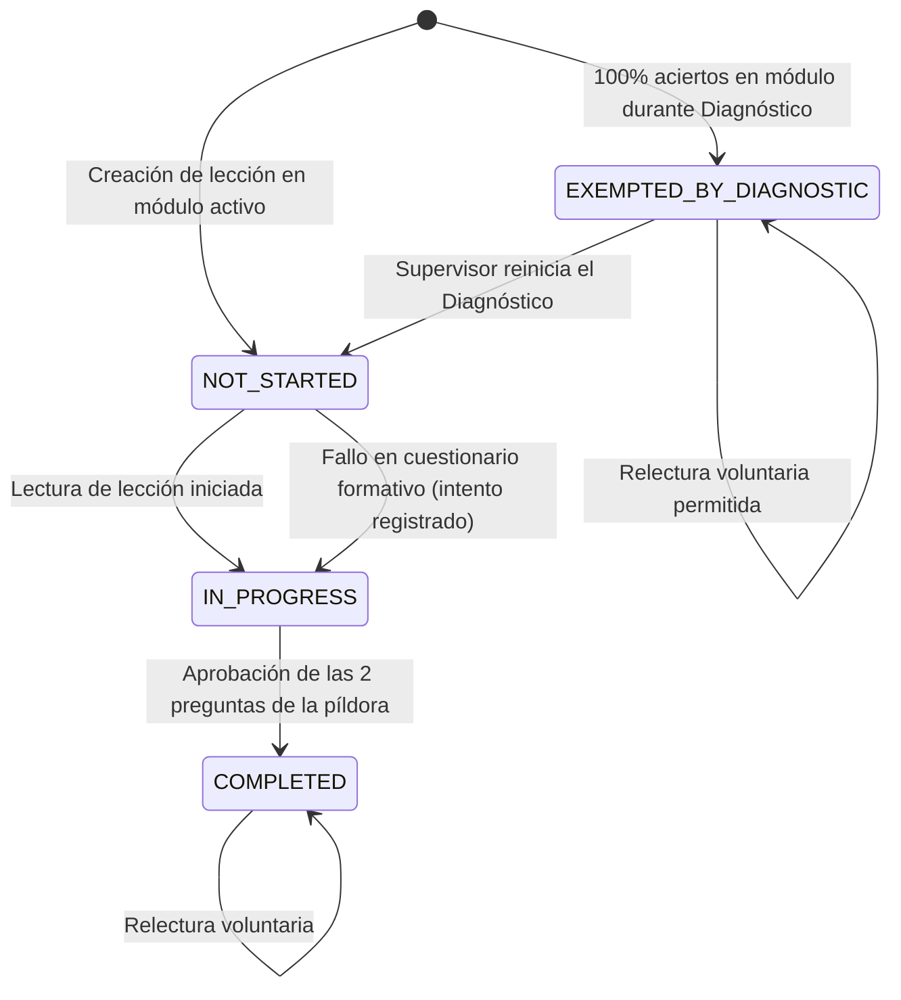

# Data Model: 015 — Diagnóstico Inicial y Progresión por Puesto

**Feature**: `015-diagnostico-inicial-y-progresion`  
**Fecha**: 2026-10-04  

---

## 1. Extensiones al Esquema Prisma (`schema.prisma`)

```prisma
// --- Modificación de Enum Existente ---

enum TrainingProgressStatus {
  NOT_STARTED
  IN_PROGRESS
  COMPLETED
  EXEMPTED_BY_DIAGNOSTIC // Aprobado y salteado tras el test diagnóstico inicial
}

// --- Nuevos Modelos ---

/// Registro de la sesión de diagnóstico inicial rendida por un empleado.
model DiagnosticSession {
  id                String    @id @default(uuid())
  employeeId        String
  score             Float     // Porcentaje total de aciertos (0.0 a 100.0)
  totalQuestions    Int
  correctAnswers    Int
  exemptedModuleIds String[]  @default([]) // IDs de los TrainingModule eximidos con 100% de aciertos
  answers           Json      // Detalle de respuestas enviadas [{ pillId, questionId, selectedOption, isCorrect }]
  
  // Auditoría y Reinicio por Supervisor (Principio III)
  isReset           Boolean   @default(false)
  resetById         String?
  resetBy           Employee? @relation("DiagnosticResetBy", fields: [resetById], references: [id])
  resetAt           DateTime?
  
  completedAt       DateTime  @default(now())
  createdAt         DateTime  @default(now())

  employee          Employee  @relation("EmployeeDiagnostics", fields: [employeeId], references: [id], onDelete: Cascade)

  @@index([employeeId, isReset])
  @@map("diagnostic_sessions")
}
```

En el modelo `Employee`:
```prisma
  // Spec 015 — Diagnóstico Inicial
  diagnosticSessions DiagnosticSession[] @relation("EmployeeDiagnostics")
  diagnosticsReset   DiagnosticSession[] @relation("DiagnosticResetBy")
```

---

## 2. Estructura de Datos JSON de Diagnóstico

### Detalle de Pregunta Entregada al Empleado (Sanitizada)
```typescript
export interface DiagnosticQuestionDto {
  moduleId: string;
  moduleTitle: string;
  pillId: string;
  pillTitle: string;
  questionId: number;
  question: string;
  options: string[]; // 3 a 4 opciones (correctOptionIndex y explanation ocultos)
}
```

### Detalle de Respuestas Enviadas (`POST /training/diagnostic/submit`)
```typescript
export interface DiagnosticSubmissionAnswerDto {
  pillId: string;
  questionId: number;
  selectedOptionIndex: number;
}

export class SubmitDiagnosticDto {
  answers: DiagnosticSubmissionAnswerDto[];
}
```

### Informe de Resultados del Diagnóstico
```typescript
export interface DiagnosticResultDto {
  sessionId: string;
  score: number;             // Ej: 85.5
  totalQuestions: number;    // Ej: 7
  correctAnswers: number;    // Ej: 6
  exemptedModules: {
    id: string;
    title: string;
  }[];
  pendingModules: {
    id: string;
    title: string;
  }[];
  message: string;
}
```

---

## 3. Máquina de Estados de Progreso del Empleado (`TrainingProgressStatus`)



---

## 4. Reglas de Desbloqueo y Candados Secuenciales

1. **Orden 0**: El primer módulo y su primera píldora siempre están desbloqueados (`isLocked: false`).
2. **Efecto de Exención**: Si un módulo tiene todas sus píldoras en `EXEMPTED_BY_DIAGNOSTIC`, se computa como aprobado a efectos de la progresión, desbloqueando automáticamente la primera píldora del siguiente módulo.
3. **Revisión Libre**: El empleado puede acceder mediante `GET /training/pills/:id` a cualquier píldora con estado `EXEMPTED_BY_DIAGNOSTIC` sin que se le exija rendir el quiz de píldora ni perder su exención.
