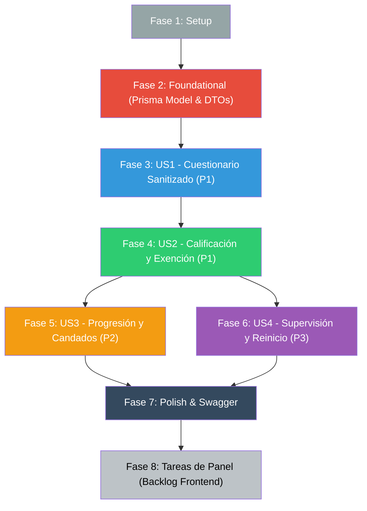

# Tasks: Diagnóstico Inicial y Progresión por Puesto

**Input**: Documentos de diseño en `specs/015-diagnostico-inicial-y-progresion/`  
**Prerequisites**: [plan.md](./plan.md), [spec.md](./spec.md), [research.md](./research.md), [data-model.md](./data-model.md), [contracts/diagnostic-api.yaml](./contracts/diagnostic-api.yaml), [quickstart.md](./quickstart.md)

**Tests**: Incluidos. La especificación toca evaluación de conocimientos, sanitización de datos, permisos de supervisión por sector (`assertPuedeEscribir`) y cálculo dinámico de candados; las pruebas unitarias e integradas son obligatorias antes de cerrar cada fase (Principio V y CLAUDE.md).

## Format: `[ID] [P?] [Story] Descripción con ruta de archivo`

- **[P]**: Puede ejecutarse en paralelo (archivos distintos, sin dependencias pendientes).
- **[US#]**: A qué historia de usuario pertenece (obligatorio en fases de historias).

## Path Conventions

Backend NestJS en `src/`, schema en `prisma/`, tests `*.spec.ts` junto al código.  
Tareas de frontend al final corresponden al repositorio hermano `trimIA-frontend`.

---

## Phase 1: Setup — Configuración y Línea Base

**Purpose**: Verificar el entorno de desarrollo, servicios de contenedores y suite de pruebas base antes de introducir cambios.

- [X] T001 Verificar estado del entorno Docker (`docker compose ps`) y conexión activa a PostgreSQL y Redis
- [X] T002 Ejecutar suite de pruebas de regresión base (`npm test -- src/training`) asegurando que los tests de la spec 014 pasan en verde
- [X] T003 Confirmar existencia de usuarios de prueba en `prisma/seed.ts`: Silvia Ríos (Cobranzas), Diego Bazán (todas las áreas) y empleados asignados a sectores

---

## Phase 2: Foundational — Modelos de Datos y Migración

**Purpose**: Establecer las entidades de persistencia en Prisma y DTOs comunes que bloquean a todas las historias de usuario.

**⚠️ CRÍTICO: Ninguna historia de usuario puede implementarse hasta completar esta fase.**

- [X] T004 Agregar valor `EXEMPTED_BY_DIAGNOSTIC` al enum `TrainingProgressStatus` en `prisma/schema.prisma`
- [X] T005 Agregar modelo `DiagnosticSession` con campos `id`, `employeeId`, `score`, `totalQuestions`, `correctAnswers`, `exemptedModuleIds`, `answers` (Json), `isReset`, `resetById`, `resetAt`, `completedAt` y relaciones con `Employee` en `prisma/schema.prisma`
- [X] T006 Ejecutar `npx prisma db push` para aplicar el modelo y enum a PostgreSQL en Docker
- [X] T007 Ejecutar `npx prisma generate` para actualizar los tipos del cliente Prisma
- [X] T008 [P] Crear DTOs de preguntas sanitizadas en `src/training/dto/diagnostic-quiz.dto.ts` definiendo `DiagnosticQuestionDto` y `DiagnosticQuizResponseDto`
- [X] T009 [P] Crear DTO de envío de respuestas en `src/training/dto/submit-diagnostic.dto.ts` con validación estricta de array de respuestas
- [X] T010 [P] Crear DTOs de resultados y métricas en `src/training/dto/diagnostic-result.dto.ts` y `src/training/dto/supervisor-diagnostic.dto.ts`

**Checkpoint**: Base de datos sincronizada y DTOs base listos para las historias de usuario.

---

## Phase 3: User Story 1 — Generación y Sanitización del Test Diagnóstico Inicial (Priority: P1) 🎯 MVP (Parte 1)

**Goal**: Permitir al empleado autenticado solicitar su test diagnóstico inicial (`GET /training/diagnostic`), recibiendo entre 5 y 8 preguntas extraídas representativamente de píldoras publicadas de su sector y módulos generales con sanitización absoluta (cero exposición de respuestas correctas ni explicaciones).

**Independent Test**: Invocar `GET /training/diagnostic` con token de empleado; verificar que devuelve 5-8 preguntas de su sector y transversales, sin los campos `correctOptionIndex` ni `explanation`, y que un segundo intento devuelve `400 Bad Request` si ya tiene un diagnóstico activo.

### Implementation for User Story 1

- [X] T011 [US1] En `TrainingService` (`src/training/training.service.ts`), implementar método auxiliar de sampling y sanitización `getDiagnosticQuestions(employeeId: string)` que seleccione de 5 a 8 preguntas de píldoras en `PUBLISHED` del sector y generales, ocultando `correctOptionIndex` y `explanation`
- [X] T012 [US1] En `TrainingService` (`src/training/training.service.ts`), agregar validación que impida solicitar el diagnóstico si el empleado ya completó una sesión no reseteada (`isReset: false`), arrojando `BadRequestException`
- [X] T013 [US1] En `TrainingController` (`src/training/training.controller.ts`), implementar el endpoint `GET /training/diagnostic` decorado con Swagger y `JwtAuthGuard`
- [X] T014 [US1] Crear pruebas unitarias en `src/training/training.service.spec.ts` y `src/training/training.controller.spec.ts` para verificar la generación de 5 a 8 preguntas, sanitización de campos sensibles y bloqueo de doble rendición

**Checkpoint**: El empleado puede obtener su cuestionario diagnóstico seguro y balanceado.

---

## Phase 4: User Story 2 — Calificación Automática y Exención por Módulo (Priority: P1) 🎯 MVP (Parte 2)

**Goal**: Procesar las respuestas enviadas (`POST /training/diagnostic/submit`), evaluar las respuestas contra las píldoras correspondientes, calcular el porcentaje de aciertos por módulo y global, registrar la `DiagnosticSession`, y marcar con `EXEMPTED_BY_DIAGNOSTIC` en `EmployeeProgress` las píldoras de los módulos que obtuvieron 100% de aciertos.

**Independent Test**: Enviar respuestas con 100% de aciertos en las preguntas de un módulo y 50% en otro; verificar que `POST /training/diagnostic/submit` retorna la lista de módulos eximidos y pendientes, y que en la base de datos las píldoras del módulo con 100% tienen status `EXEMPTED_BY_DIAGNOSTIC`.

### Implementation for User Story 2

- [X] T015 [US2] En `TrainingService` (`src/training/training.service.ts`), implementar método `submitDiagnostic(employeeId: string, dto: SubmitDiagnosticDto)` que evalúe cada respuesta contra el `quiz` de la píldora correspondiente
- [X] T016 [US2] En `TrainingService` (`src/training/training.service.ts`), implementar la regla de exención por módulo: si todas las preguntas pertenecientes a un módulo fueron respondidas correctamente (100% de aciertos), marcar todas las píldoras de ese módulo en `EmployeeProgress` con `status: EXEMPTED_BY_DIAGNOSTIC`
- [X] T017 [US2] En `TrainingService` (`src/training/training.service.ts`), persistir la entidad `DiagnosticSession` en la base de datos con el puntaje general, módulos eximidos, cantidad de preguntas y respuestas enviadas
- [X] T018 [US2] En `TrainingController` (`src/training/training.controller.ts`), implementar el endpoint `POST /training/diagnostic/submit` retornando `DiagnosticResultResponse`
- [X] T019 [US2] Crear pruebas unitarias en `src/training/training.service.spec.ts` para calificar respuestas, verificar exención del 100%, rechazo de exención con fallos parciales y persistencia de `DiagnosticSession`

**Checkpoint**: Calificación automática y exención adaptativa completas. MVP operativo.

---

## Phase 5: User Story 3 — Progresión Formativa y Desbloqueo Adaptativo con Candados (Priority: P2)

**Goal**: Actualizar la lógica de consulta de módulos y píldoras (`GET /training/modules` y `GET /training/pills/:id`) para que los módulos y píldoras con estado `EXEMPTED_BY_DIAGNOSTIC` computen como completados para desbloquear la siguiente lección (`isLocked: false`), permitiendo al empleado repasar libremente las lecciones eximidas.

**Independent Test**: Consultar `GET /training/modules` con un empleado que tiene el Módulo 1 en `EXEMPTED_BY_DIAGNOSTIC`; verificar que la primera píldora del Módulo 2 aparece desbloqueada (`isLocked: false`), y que `GET /training/pills/:id` permite leer una píldora eximida sin restricciones.

### Implementation for User Story 3

- [X] T020 [US3] Actualizar `EmployeePillSummaryDto` en `src/training/dto/employee-training.dto.ts` para incluir el estado `status: TrainingProgressStatus` y bandera `isExempted: boolean`
- [X] T021 [US3] En `TrainingService` (`src/training/training.service.ts`), modificar `getEmployeeModules` para que tanto `COMPLETED` como `EXEMPTED_BY_DIAGNOSTIC` se consideren aprobados al calcular `previousPillCompleted` y desbloquear lecciones subsiguientes
- [X] T022 [US3] En `TrainingService` (`src/training/training.service.ts`), asegurar que `getEmployeePill` permita la lectura de píldoras con estado `EXEMPTED_BY_DIAGNOSTIC` sin bloquear el acceso ni exigir nuevo quiz
- [X] T023 [US3] Crear pruebas unitarias en `src/training/training.service.spec.ts` para verificar el desbloqueo secuencial con píldoras eximidas y el acceso voluntario de lectura

**Checkpoint**: Rutas de aprendizaje adaptativas con candados secuenciales respetando exenciones.

---

## Phase 6: User Story 4 — Seguimiento y Reinicio de Diagnóstico para Supervisores (Priority: P3)

**Goal**: Proveer a los supervisores endpoints para consultar el historial diagnóstico de empleados de su sector y reiniciar el diagnóstico archivando la sesión y reseteando las exenciones cuando corresponda, aplicando rigurosamente `assertPuedeEscribir`.

**Independent Test**: Con token de supervisor de Cobranzas, consultar `GET /training/supervisor/diagnostic/:employeeId` y ejecutar `POST /training/supervisor/diagnostic/:employeeId/reset` con éxito; intentar lo mismo con token de supervisor de Ventas y recibir `403 Forbidden`.

### Implementation for User Story 4

- [X] T024 [US4] En `TrainingService` (`src/training/training.service.ts`), implementar `getSupervisorEmployeeDiagnostic(supervisorId: string, employeeId: string)` con verificación de sector mediante `KnowledgeService.assertPuedeEscribir` (Principio I)
- [X] T025 [US4] En `TrainingService` (`src/training/training.service.ts`), implementar `resetEmployeeDiagnostic(supervisorId: string, employeeId: string)` que marque `isReset: true`, `resetById: supervisorId`, `resetAt: now()`, y restablezca a `NOT_STARTED` las píldoras del empleado que estaban en `EXEMPTED_BY_DIAGNOSTIC`
- [X] T026 [US4] En `TrainingSupervisorController` (`src/training/training-supervisor.controller.ts`), agregar endpoints `GET /training/supervisor/diagnostic/:employeeId` y `POST /training/supervisor/diagnostic/:employeeId/reset` con decoradores de rol y Swagger
- [X] T027 [US4] Crear pruebas unitarias en `src/training/training.service.spec.ts` para consulta de diagnóstico, reinicio de exenciones, auditoría de usuario que resetea y denegación 403 ante supervisores ajenos

**Checkpoint**: Supervisión con control de sector y gobernanza de excepciones (Humano en el Loop).

---

## Phase 7: Polish & Cross-Cutting Concerns

**Purpose**: Ajustes finales, documentación OpenAPI, validación contra quickstart y verificación de calidad integral.

- [X] T028 [P] Actualizar decoradores de Swagger `@ApiTags`, `@ApiOperation` y `@ApiResponse` en controladores y DTOs de `src/training/`
- [X] T029 Ejecutar validación de los 3 escenarios descritos en `specs/015-diagnostico-inicial-y-progresion/quickstart.md`
- [X] T030 Correr suite completa de pruebas unitarias (`npm test -- src/training`) asegurando que el 100% de los tests pasen en verde y `npm run build` compile sin errores

---

## Phase 8: Cierre de Spec — Tareas de Panel (Frontend en `trimIA-frontend`)

**Purpose**: Enumerar las tareas necesarias para ejercitar estos endpoints desde el frontend de pruebas, cumpliendo con la regla constitucional de cierre de spec. *(Estas tareas se enumeran para el backlog del panel y se implementan posteriormente)*.

- [ ] T031 [Panel] Implementar métodos de diagnóstico en `training.service.ts` de `trimIA-frontend` (`getDiagnosticQuiz`, `submitDiagnostic`, `getSupervisorEmployeeDiagnostic`, `resetEmployeeDiagnostic`)
- [ ] T032 [Panel] Diseñar e implementar pantalla de Evaluación Diagnóstica Inicial (`DiagnosticQuizView`) para empleados mostrando las 5-8 preguntas con opciones de selección única y barra de avance de 5 minutos
- [ ] T033 [Panel] Implementar vista/modal de Resultados del Diagnóstico (`DiagnosticResultModal`) mostrando porcentaje obtenido, desglose de módulos eximidos vs pendientes y botón para ir a la ruta de aprendizaje
- [ ] T034 [Panel] Actualizar vista de Inicio de Capacitación (`TrainingHomeView`) para reflejar visualmente las píldoras y módulos eximidos con badge verde "Eximido por diagnóstico" y candados abiertos
- [ ] T035 [Panel] Agregar sección en el panel de supervisión (`SupervisorEmployeeDetailView`) para ver el diagnóstico del empleado y botón "Reiniciar Diagnóstico" con confirmación modal

---

## Dependencies & Execution Order

### Oportunidades de Paralelismo
- **T008, T009 y T010**: Creación de DTOs en `src/training/dto/` puede realizarse en paralelo una vez completada la generación de Prisma (T007).
- **T020 y T028**: Ajustes de interfaces DTO y decoradores Swagger pueden ejecutarse en paralelo.
- **US3 (Fase 5) y US4 (Fase 6)**: Ambas dependen de la evaluación del diagnóstico (Fase 4) pero operan sobre superficies diferentes (flujo de empleado vs flujo de supervisor) y pueden implementarse independientemente.

### Estrategia de Entrega
- **MVP (Fases 1, 2, 3 y 4)**: Entrega la capacidad fundamental de diagnóstico inicial: generación de preguntas balanceadas y sanitizadas, evaluación automática de respuestas y exención en `EmployeeProgress` (`EXEMPTED_BY_DIAGNOSTIC`).
- **Incremento 2 (Fase 5)**: Habilita el impacto formativo en la navegación del empleado: desbloqueo dinámico de candados posteriores y revisión voluntaria de píldoras eximidas.
- **Incremento 3 (Fase 6)**: Agrega la gobernanza de supervisión: auditoría de resultados y facultad de reinicio respetando `assertPuedeEscribir`.
- **Cierre (Fases 7 y 8)**: Documentación OpenAPI, validación con Quickstart y especificación del backlog de UI para `trimIA-frontend`.

---

## Resumen

| Fase | Tareas | Responsabilidad |
|---|---|---|
| 1 — Setup | T001–T003 | Línea base y entorno |
| 2 — Foundational | T004–T010 | Esquema Prisma, migraciones y DTOs de diagnóstico |
| 3 — US1: Cuestionario sanitizado | T011–T014 | Muestreo de 5-8 preguntas, sanitización y endpoint |
| 4 — US2: Calificación y exención | T015–T019 | Evaluación, regla del 100%, exención y sesión |
| 5 — US3: Progresión y candados | T020–T023 | Candados adaptativos y consulta voluntaria |
| 6 — US4: Supervisión y reinicio | T024–T027 | Métricas, reset de exenciones y `assertPuedeEscribir` |
| 7 — Polish & Validación | T028–T030 | Swagger, Quickstart y suite de tests |
| 8 — Cierre: Tareas de Panel | T031–T035 | Backlog de UI en `trimIA-frontend` (Constitución) |

**Total de tareas**: 35 tareas (30 tareas de backend ejecutables + 5 tareas de panel enumeradas para backlog).

