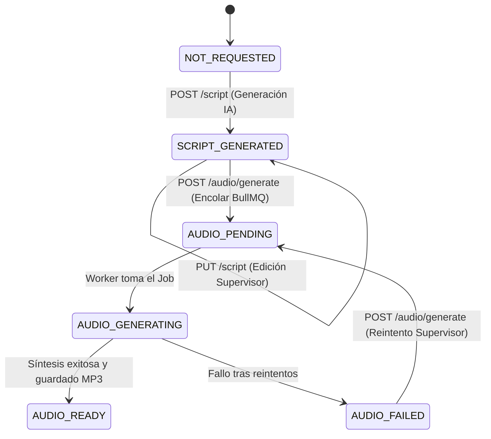

# Data Model: 016 — Pipeline de Audio: Guion a 2 Voces y Síntesis TTS

**Feature**: [spec.md](./spec.md)  
**Status**: Completed  
**Date**: 2026-10-06  

---

## 1. Modificaciones a Modelos Existentes en Prisma

### 1.1 Nuevo Enum: `AudioStatus`

Representa el ciclo de vida de la producción de audio para una píldora formativa:

```prisma
enum AudioStatus {
  NOT_REQUESTED      // Sin solicitud de guion ni audio
  SCRIPT_GENERATED   // Guion a 2 voces generado por IA o editado por supervisor
  AUDIO_PENDING      // Encolado en BullMQ para procesamiento asíncrono
  AUDIO_GENERATING   // El worker BullMQ se encuentra sintetizando la voz
  AUDIO_READY        // Archivo MP3 generado, almacenado y listo para streaming
  AUDIO_FAILED       // Fallo en la síntesis tras reintentos (permite reintento)
}
```

---

### 1.2 Extensión del Modelo `Pill` en `prisma/schema.prisma`

Se incorporan campos para almacenar el guion estructurado, los metadatos del audio y el estado de la cola:

```prisma
model Pill {
  // ... campos existentes (id, moduleId, title, objective, content, quiz, status, orderIndex, etc.)

  // Spec 016 — Pipeline de Audio y TTS
  audioStatus          AudioStatus @default(NOT_REQUESTED)
  audioScript          Json?       // { estimatedDurationSeconds: number, dialogue: [{ speaker: "SPEAKER_1"|"SPEAKER_2", text: string }] }
  audioUrl             String?     // Ruta interna o URI del archivo generado (ej. "storage/audio/pill-xxx.mp3")
  audioDurationSeconds Int?        // Duración total calculada del audio en segundos
  audioError           String?     // Mensaje descriptivo si audioStatus == AUDIO_FAILED
  audioGeneratedAt     DateTime?   // Fecha/hora de finalización exitosa de la síntesis

  // ... relaciones existentes
}
```

---

### 1.3 Extensión del Modelo `EmployeeProgress` en `prisma/schema.prisma`

Permite rastrear el avance de reproducción por píldora y verificar el umbral del 80%:

```prisma
model EmployeeProgress {
  // ... campos existentes (id, employeeId, pillId, status, attempts, lastAnswers, completedAt, etc.)

  // Spec 016 — Progreso de Escucha de Audio
  playbackProgressSeconds Int       @default(0) // Segundos reproducidos acumulados
  isAudioCompleted        Boolean   @default(false) // Se activa al alcanzar >= 80% de audioDurationSeconds
  lastPlaybackReportAt    DateTime? // Estampa temporal para validar incremento realista y evitar saltos fraudulentos

  // ... relaciones existentes
}
```

---

## 2. Tipos y DTOs en TypeScript

### 2.1 Estructura del Guion (`src/training/dto/audio-script.dto.ts`)

```typescript
export enum SpeakerRole {
  SPEAKER_1 = 'SPEAKER_1', // Conductor/a principal
  SPEAKER_2 = 'SPEAKER_2', // Copresentador/a con modismos regionales
}

export class DialogueLineDto {
  speaker: SpeakerRole;
  text: string;
}

export class AudioScriptDto {
  title: string;
  estimatedDurationSeconds: number;
  dialogue: DialogueLineDto[];
}
```

---

### 2.2 Avance de Reproducción (`src/training/dto/playback-progress.dto.ts`)

```typescript
export class ReportPlaybackProgressDto {
  currentSeconds: number; // Posición actual reportada por el reproductor
}

export class PlaybackProgressResponseDto {
  pillId: string;
  playbackProgressSeconds: number;
  totalDurationSeconds: number;
  percentage: number;
  isAudioCompleted: boolean;
  message: string;
}
```

---

### 2.3 Estado del Audio (`src/training/dto/audio-status.dto.ts`)

```typescript
export class AudioStatusResponseDto {
  pillId: string;
  status: AudioStatus;
  hasScript: boolean;
  hasAudio: boolean;
  durationSeconds?: number;
  error?: string;
  streamUrl?: string;
}
```

---

## 3. Diagrama de Transición de Estados del Audio


