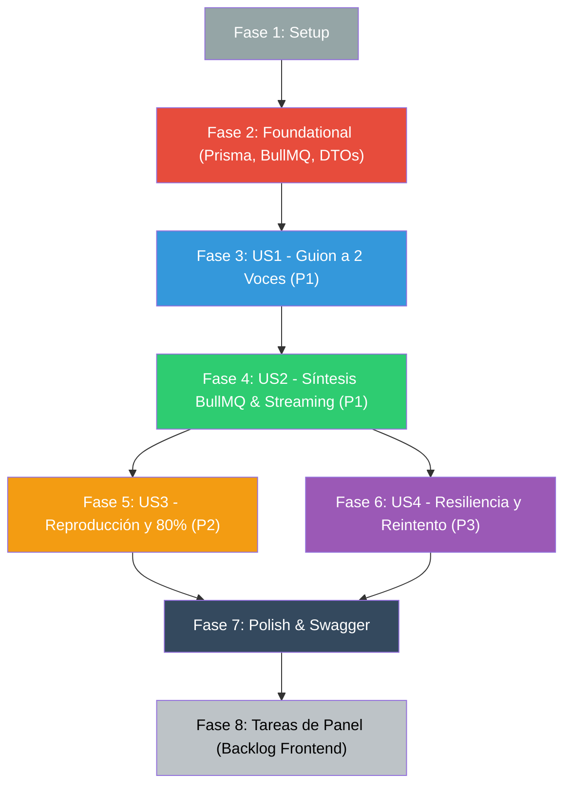

# Tasks: 016 — Pipeline de Audio: Guion a 2 Voces y Síntesis TTS

**Input**: Documentos de diseño en `specs/016-pipeline-audio-guion-tts/`  
**Prerequisites**: [plan.md](./plan.md), [spec.md](./spec.md), [research.md](./research.md), [data-model.md](./data-model.md), [contracts/audio-api.yaml](./contracts/audio-api.yaml), [quickstart.md](./quickstart.md)

**Tests**: Obligatorios para la lógica de síntesis, encolado en BullMQ, streaming con Range y validación temporal del 80% (Principio I, II, IV y CLAUDE.md).

## Format: `[ID] [P?] [Story] Descripción con ruta de archivo`

- **[P]**: Puede ejecutarse en paralelo (archivos distintos, sin dependencias pendientes).
- **[US#]**: A qué historia de usuario pertenece (obligatorio en fases de historias).

## Path Conventions

Backend NestJS en `src/`, schema en `prisma/`, tests `*.spec.ts` junto al código.  
Tareas de frontend al final corresponden al repositorio hermano `trimIA-frontend` (Principio V y Regla de Cierre de Spec).

---

## Phase 1: Setup — Configuración y Línea Base

**Purpose**: Verificar el entorno de desarrollo, contenedores y dependencias antes de introducir cambios.

- [X] T001 Verificar estado del entorno Docker (`docker compose ps`) asegurando conectividad con PostgreSQL y Redis
- [X] T002 Ejecutar suite de pruebas de regresión base (`npm test -- src/training`) asegurando que los tests de las specs 014 y 015 pasen en verde
- [X] T003 Asegurar la existencia del directorio persistente `storage/audio/` para desarrollo en el host y contenedor

---

## Phase 2: Foundational — Modelos de Datos, Storage y Cola BullMQ

**Purpose**: Establecer las entidades de persistencia en Prisma, DTOs y servicios base que bloquean a todas las historias de usuario.

**⚠️ CRÍTICO: Ninguna historia de usuario puede implementarse hasta completar esta fase.**

- [X] T004 Agregar enum `AudioStatus` (`NOT_REQUESTED`, `SCRIPT_GENERATED`, `AUDIO_PENDING`, `AUDIO_GENERATING`, `AUDIO_READY`, `AUDIO_FAILED`) en `prisma/schema.prisma`
- [X] T005 Extender el modelo `Pill` con campos `audioStatus`, `audioScript` (Json), `audioUrl`, `audioDurationSeconds`, `audioError` y `audioGeneratedAt` en `prisma/schema.prisma`
- [X] T006 Extender el modelo `EmployeeProgress` con campos `playbackProgressSeconds`, `isAudioCompleted` y `lastPlaybackReportAt` en `prisma/schema.prisma`
- [X] T007 Aplicar cambios de esquema en PostgreSQL con `npx prisma db push` y regenerar cliente con `npx prisma generate`
- [X] T008 [P] Crear DTOs del guion de audio en `src/training/dto/audio-script.dto.ts` definiendo `SpeakerRole`, `DialogueLineDto`, `AudioScriptDto` y `UpdateAudioScriptDto`
- [X] T009 [P] Crear DTOs de estado de audio en `src/training/dto/audio-status.dto.ts` definiendo `AudioStatusResponseDto`
- [X] T010 [P] Crear DTOs de progreso de reproducción en `src/training/dto/playback-progress.dto.ts` definiendo `ReportPlaybackProgressDto` y `PlaybackProgressResponseDto`
- [X] T011 [P] Implementar el servicio `AudioStorageService` en `src/training/services/audio-storage.service.ts` con métodos `saveAudio`, `getAudioMetadata` y `createAudioStream` con soporte de cabecera HTTP `Range`
- [X] T012 [P] Implementar el servicio `TtsService` en `src/training/services/tts.service.ts` para síntesis multilocutor con cliente Gemini / fallback estructurado
- [X] T013 Registrar la cola BullMQ `'training-audio'` y los nuevos servicios en `src/training/training.module.ts`

**Checkpoint**: Base de datos sincronizada, cola BullMQ registrada y servicios de storage/TTS listos.

---

## Phase 3: User Story 1 — Generación y Edición del Guion a 2 Voces (Priority: P1) 🎯 MVP (Parte 1)

**Goal**: Permitir al supervisor generar automáticamente con IA un guion a dos voces (conductor y copresentador con modismos rioplatenses naturales) a partir del contenido de una píldora aprobada, y poder editar los parlamentos antes de la síntesis.

**Independent Test**: Invocar `POST /training/pills/:id/script` con token de supervisor de Cobranzas; verificar que retorna un diálogo de 2 personajes (`SPEAKER_1` y `SPEAKER_2`) menor a 5 minutos, editarlo con `PUT /training/pills/:id/script`, y consultar la transcripción con `GET /training/pills/:id/script`.

### Implementation for User Story 1

- [X] T014 [US1] En `TrainingService` (`src/training/training.service.ts`), implementar método `generatePillAudioScript(supervisorId: string, pillId: string)` que invoque a Gemini con prompt estructurado para dos locutores y guarde el guion en `Pill.audioScript` con `audioStatus: SCRIPT_GENERATED`
- [X] T015 [US1] En `TrainingService` (`src/training/training.service.ts`), implementar método `updatePillAudioScript(supervisorId: string, pillId: string, dto: UpdateAudioScriptDto)` que valide y guarde las ediciones del supervisor
- [X] T016 [US1] En `TrainingService` (`src/training/training.service.ts`), implementar método `getPillAudioScript(pillId: string)` que retorne el guion estructurado para supervisión y transcripción del empleado
- [X] T017 [US1] En `TrainingSupervisorController` (`src/training/training-supervisor.controller.ts`), implementar endpoints `POST /training/pills/:id/script` y `PUT /training/pills/:id/script` con validación de sector mediante `assertPuedeEscribir` (Principio I)
- [X] T018 [US1] En `TrainingController` (`src/training/training.controller.ts`), implementar endpoint `GET /training/pills/:id/script` decorado con Swagger y `JwtAuthGuard`
- [X] T019 [US1] Crear pruebas unitarias en `src/training/training.service.spec.ts` y controladores para verificar la generación de diálogo a 2 voces, edición de parlamentos y denegación 403 por sector ajeno

**Checkpoint**: El supervisor puede generar y pulir guiones de podcast a dos voces de forma segura.

---

## Phase 4: User Story 2 — Síntesis Asíncrona de Audio TTS y Streaming HTTP (Priority: P1) 🎯 MVP (Parte 2)

**Goal**: Encolar en BullMQ la síntesis de voz del guion aprobado (`POST /training/pills/:id/audio/generate`), procesarla en segundo plano con dos timbres diferenciados, guardar el MP3 en disco persistente y servirlo vía streaming HTTP (`GET /training/pills/:id/audio`) con soporte `Range`.

**Independent Test**: Disparar la generación de audio; verificar que responde `202 Accepted` de inmediato con status `AUDIO_PENDING`, que el worker procesa el audio generando el MP3 en `storage/audio/`, y que una petición con cabecera `Range: bytes=0-1024` responde `206 Partial Content`.

### Implementation for User Story 2

- [X] T020 [US2] Crear el procesador BullMQ `AudioGenerationProcessor` en `src/training/processors/audio-generation.processor.ts` para procesar el job `'generate-audio'`, actualizando a `AUDIO_GENERATING`, invocando `TtsService` y persistiendo el archivo MP3 mediante `AudioStorageService` a `AUDIO_READY`
- [X] T021 [US2] En `TrainingService` (`src/training/training.service.ts`), implementar método `enqueueAudioGeneration(supervisorId: string, pillId: string)` que valide la existencia del guion, verifique sector con `assertPuedeEscribir`, pase el estado a `AUDIO_PENDING` y encole el job en BullMQ
- [X] T022 [US2] En `TrainingSupervisorController` (`src/training/training-supervisor.controller.ts`), implementar endpoint `POST /training/pills/:id/audio/generate` retornando `202 Accepted`
- [X] T023 [US2] En `TrainingController` (`src/training/training.controller.ts`), implementar endpoint de consulta de estado `GET /training/pills/:id/audio/status` y endpoint de streaming `GET /training/pills/:id/audio` con soporte para cabecera `Range` (`206 Partial Content`)
- [X] T024 [US2] Crear pruebas unitarias en `src/training/training.service.spec.ts` para el encolado en BullMQ, procesamiento del worker y respuestas de streaming parcial

**Checkpoint**: Pipeline de audio asíncrono y streaming operativo. MVP completo.

---

## Phase 5: User Story 3 — Reproducción y Desbloqueo Adaptativo al 80% (Priority: P2)

**Goal**: Registrar el avance de reproducción del empleado (`POST /training/pills/:id/playback-progress`), validar que el avance sea continuo y libre de saltos fraudulentos, y marcar la lección como completada en audio (`isAudioCompleted = true`) al alcanzar el 80% del tiempo total.

**Independent Test**: Enviar reportes progresivos de 30s, 60s, hasta superar el 80% de la duración del audio; verificar que el backend devuelve `isAudioCompleted: true` y que saltos repentinos sin tiempo transcurrido son ignorados.

### Implementation for User Story 3

- [X] T025 [US3] En `TrainingService` (`src/training/training.service.ts`), implementar método `recordPlaybackProgress(employeeId: string, pillId: string, currentSeconds: number)` con algoritmo antifraude (comparación con `lastPlaybackReportAt`) y activación de `isAudioCompleted: true` al alcanzar el 80% de `audioDurationSeconds`
- [X] T026 [US3] En `TrainingController` (`src/training/training.controller.ts`), implementar endpoint `POST /training/pills/:id/playback-progress` retornando `PlaybackProgressResponseDto`
- [X] T027 [US3] En `TrainingService` (`src/training/training.service.ts`), actualizar `getEmployeePill` y `getEmployeeModules` para incluir `hasAudio`, `audioStatus`, `audioDurationSeconds` y el progreso de escucha `isAudioCompleted` del empleado
- [X] T028 [US3] Crear pruebas unitarias en `src/training/training.service.spec.ts` para el cálculo de porcentaje, bloqueo de saltos fraudulentos y activación de `isAudioCompleted`

**Checkpoint**: Tracking de audio y desbloqueo al 80% validado.

---

## Phase 6: User Story 4 — Resiliencia ante Fallos y Reintento de Síntesis (Priority: P3)

**Goal**: Garantizar que errores de cuota o timeouts en el modelo de voz sean capturados por el worker, registrando `AUDIO_FAILED` y permitiendo al supervisor reintentar la generación sin perder el guion ni romper la píldora teórica.

**Independent Test**: Simular un error en el proveedor TTS; verificar que la píldora queda en `AUDIO_FAILED` con mensaje de error, y que un nuevo llamado a `POST /training/pills/:id/audio/generate` reencola la tarea limpiamente.

### Implementation for User Story 4

- [X] T029 [US4] En `AudioGenerationProcessor` (`src/training/processors/audio-generation.processor.ts`), capturar excepciones al agotar reintentos de BullMQ, registrando `audioStatus: AUDIO_FAILED` y guardando el mensaje en `Pill.audioError`
- [X] T030 [US4] En `TrainingService` (`src/training/training.service.ts`), permitir que `enqueueAudioGeneration` acepte píldoras en estado `AUDIO_FAILED` para reiniciar el ciclo a `AUDIO_PENDING`
- [X] T031 [US4] Crear pruebas unitarias en `src/training/training.service.spec.ts` simulando fallos de síntesis y reintentos del supervisor

**Checkpoint**: Resiliencia y auto-recuperación de jobs de audio completada.

---

## Phase 7: Polish & Cross-Cutting Concerns

**Purpose**: Documentación Swagger, validación de integración contra quickstart y verificación de calidad.

- [X] T032 [P] Actualizar anotaciones OpenAPI `@ApiTags('Capacitación')`, `@ApiOperation` y `@ApiResponse` en controladores y DTOs de `src/training/`
- [X] T033 Ejecutar y validar los 4 escenarios de integración descritos en `specs/016-pipeline-audio-guion-tts/quickstart.md`
- [X] T034 Correr suite completa de pruebas unitarias (`npm test -- src/training`) asegurando 100% de tests en verde y compilación limpia con `npm run build`

---

## Phase 8: Cierre de Spec — Tareas de Panel (Frontend en `trimIA-frontend`)

**Purpose**: Enumerar las tareas necesarias para ejercitar estos endpoints desde el frontend de pruebas, cumpliendo con la regla constitucional de cierre de spec. *(Estas tareas se enumeran para el backlog del panel y se implementan posteriormente)*.

- [X] T035 [Panel] Implementar métodos de audio en `api.js` de `trimIA-frontend` (`generateAudioScript`, `updateAudioScript`, `enqueueAudioGeneration`, `getAudioStatus`, `reportPlaybackProgress`)
- [X] T036 [Panel] Diseñar e implementar modal de revisión y edición del guion a 2 voces para el supervisor (`AudioScriptModal.jsx`) con previsualización de personajes
- [X] T037 [Panel] Integrar reproductor de podcast en `PillStudyModal.jsx` con controles de reproducción, barra de avance, streaming de audio y visualización del diálogo sincronizado
- [X] T038 [Panel] Implementar reporte periódico de progreso de reproducción en el reproductor web con indicador de desbloqueo al alcanzar el 80%
- [X] T039 [Panel] Agregar en `TrainingPanel.jsx` indicador de estado del audio (`AUDIO_GENERATING`, `AUDIO_READY`, `AUDIO_FAILED`) y botón de reintento para supervisores

---

## Dependencies & Execution Order

### Oportunidades de Paralelismo
- **T008, T009, T010, T011, T012**: Creación de DTOs y servicios desacoplados (`AudioStorageService`, `TtsService`) pueden desarrollarse en paralelo tras T007.
- **T032**: Decoradores de Swagger pueden agregarse en paralelo una vez definidos los controladores.

---

## Resumen de Tareas

- **Total de tareas**: 39 tareas (34 tareas de backend ejecutables + 5 tareas de panel para backlog de frontend).
- **Alcance MVP**: Fases 1 a 4 (Setup, Modelos, Guion a 2 voces y Síntesis asíncrona con Streaming).

## Phase 9: Convergence

**Revisión:** 2026-11-03. Evaluación del código actual de backend y panel; sin implementación, cambio de rama ni despliegue. Se conserva íntegro el backlog anterior, incluidas sus marcas.

**Cobertura:** 10 FR, 11 escenarios de aceptación, 4 casos límite, 6 criterios técnicos de éxito y 39 tareas existentes. Plan: guion Gemini, TTS de dos voces, cola BullMQ, MP3, volumen local, streaming Range, progreso temporal/80% y aislamiento/permisos. Contrastados los 5 principios constitucionales, las restricciones aplicables y `docs/plan_de_trabajo.md` (5C y recortes de §6).

**Límite de alcance:** resolver estos incumplimientos con los componentes existentes y regresiones específicas; no agregar proveedores, plataformas de auditoría, gamificación ni infraestructura descartada por el plan. Las cifras de latencia/uso no se declaran incumplidas sin medición. La suite existente `npm test -- --runInBand --no-cache --watch=false src/training` pasa (3 suites, 36 tests); sus mocks no acreditan por sí solos los contratos faltantes.

- [ ] T040 [CRITICAL] [016-F1] Proteger los GET de guion, estado y streaming en `src/training/training.controller.ts` y verificar acceso en `getPillAudioScript`, `getAudioStatus`, `getAudioStream` y `recordPlaybackProgress` de `training.service.ts`. Los tres GET no llevan JwtAuthGuard, no existe guard JWT global (solo ThrottlerGuard), y los servicios leen por pillId sin comprobar empleado, sector, publicación ni candado. Distinguir la revisión autorizada del supervisor del consumo del empleado; conservar el mecanismo de token del reproductor ya soportado por JwtStrategy. Agregar regresiones sin token, token revocado, DRAFT/ARCHIVED, sector ajeno y acceso válido, sin restringir la lectura del corpus. Referencias: T018/T023; plan: Constitution Check I; Constitución I; 014 FR-010 (contradicts).
- [ ] T041 [CRITICAL] [016-F2] Completar el adaptador existente `src/training/services/tts.service.ts`: `synthesizeWithGemini()` devuelve null y el fallback fabrica bytes con cabeceras MP3 sin sintetizar voz, que el worker marca AUDIO_READY. Invocar el TTS Gemini ya previsto con dos locutores, convertir la salida real a MP3 y medir su duración, aceptando éxito solo si hay audio válido; los fallos deben llegar al mecanismo de reintentos existente, conservando el texto. Reutilizar GOOGLE_API_KEY y validar/documentar cualquier configuración mantenida o nueva (hoy GEMINI_API_KEY solo aparece aquí y no tiene Joi ni .env.example); actualizar la documentación técnica del flujo. Cubrir respuesta de audio, respuesta solo textual, error y duración sin proveedor alternativo ni nueva infraestructura. Referencias: FR-004/005; US2/AC2; T012/T020/T024; plan_de_trabajo §5C.4; Constitución: configuración por entorno y tests (missing).
- [ ] T042 [HIGH] [016-F3] Validar las precondiciones y límites del guion en `src/training/training.service.ts`, `training-generator.service.ts`, `dto/audio-script.dto.ts` y `../trimIA-frontend/src/components/AudioScriptModal.jsx`: el servicio permite generarlo para cualquier estado de píldora, el objetivo se recorta a 600 s y la edición admite una sola voz y duración sin máximo. Ajustar a la píldora publicada y dos voces de la spec, resumir material extenso y comprobar ≤300 s también tras editar/fallback/síntesis, con errores claros y tests. Hacer que sintetizar use los cambios guardados o advierta que hay cambios sin guardar; no sumar un workflow separado de aprobaciones. Referencias: FR-001/002; US1/AC1–AC2; SC-003; T008/T014/T015/T036; Edge Cases: píldoras extensas (partial).
- [ ] T043 [HIGH] [016-F4] Corregir la validación temporal de `recordPlaybackProgress` (`src/training/training.service.ts:1093–1124`): sin lastPlaybackReportAt se acepta cualquier currentSeconds, y cada reporte posterior suma una tolerancia fija de 5 s que permite adelantar por repetición rápida. Exigir AUDIO_READY y duración real, establecer un inicio verificable y permitir solo avance consistente sin otorgar progreso por saltos; aplicar el 80% sin redondearlo hacia abajo. Sustituir el test actual que aprueba 85 s en el primer reporte (`training.service.spec.ts:648`) por casos de primer salto, reportes rápidos, escucha legítima, pausa/reanudación y exención, usando la solución más simple. Referencias: FR-007/008; US3/AC2–AC3; T025/T028 (contradicts).
- [ ] T044 [HIGH] [016-F5] Conectar el indicador de escucha al desbloqueo del resumen de texto en `../trimIA-frontend/src/components/PillStudyModal.jsx`: actualmente `isAudioCompleted` solo cambia el badge y el contenido teórico siempre se muestra. Aplicar la regla del 80% a las píldoras con audio disponible, actualizar la vista sin recarga y completar los metadatos de audio/progreso que T027 exige también en `getEmployeeModules` y `EmployeePillSummaryDto` (hoy solo están en el detalle). Conservar el acceso de repaso de eximidos y la lectura de píldoras sin audio o con síntesis fallida; no crear un sistema de configuración pedagógica ni imponer nuevos requisitos al resto del curso. Referencias: US3: Independent Test; SC-005; T027/T038; plan_de_trabajo §5C.6 (partial).
- [ ] T045 [HIGH] [016-F6] Cerrar las inconsistencias del ciclo de generación en `enqueueAudioGeneration`, edición de guion y `AudioGenerationProcessor`: el estado se guarda AUDIO_PENDING antes de audioQueue.add sin recuperación ante error; dos solicitudes pueden superar el chequeo y crear jobs distintos con Date.now; editar/regenerar el guion durante el trabajo permite que un resultado viejo publique AUDIO_READY. Reutilizar BullMQ y las transiciones existentes para evitar duplicados, dejar un estado reintentable si falla el encolado y no aceptar resultados de un guion reemplazado o una píldora archivada. Cubrir concurrencia, fallo al encolar y agotamiento de reintentos con tests del servicio/worker, sin otra cola ni orquestador. Referencias: FR-003/009; US4/AC1–AC2; Edge Cases: solicitud duplicada; T021/T029/T030/T031 (partial).
- [ ] T046 [HIGH] [016-F7] Reproducir el archivo generado en `../trimIA-frontend/src/components/PillStudyModal.jsx`: `handleAudioPlay` silencia el elemento audio (volume=0) y reemplaza su sonido por speechSynthesis del navegador, con otro reloj y voces distintas del TTS aprobado (líneas 171–185). Usar el MP3 válido del backend como fuente de reproducción y de progreso; mantener pausa/reanudación, controles y guion visible. Si se conserva narración del navegador como alternativa, distinguirla claramente y no usar el tiempo de un archivo silenciado para acreditar esa escucha. No agregar alineación forzada ni otro proveedor de voz. Referencias: FR-004/006; US2/AC3; US3/AC1; T037; plan_de_trabajo §5C.4 (contradicts).
- [ ] T047 [MEDIUM] [016-F8] Conectar la limpieza de archivos al archivo y reemplazo del audio en `src/training/training.service.ts` y `services/audio-storage.service.ts`. `deleteAudio` no tiene llamadores y `archivePill` solo actualiza status, dejando el archivo físico. Eliminar el audio retirado y sus referencias de forma ordenada, evitando que un worker lo reponga después del archivo y conservando el audio vigente hasta tener un reemplazo válido. Cubrir archivo y regeneración con almacenamiento temporal en tests; basta la gestión local existente, sin garbage collector ni GCS en esta etapa. Referencias: Edge Cases: eliminación o archivado de píldoras con audio; FR-009; T011/T020 (missing).
- [ ] T048 [MEDIUM] [016-F9] Corregir el soporte de rangos simples en `src/training/services/audio-storage.service.ts:107–135`: `bytes=-500` se interpreta como bytes 0–500 en lugar de los últimos 500, y un rango fuera de archivo responde como petición genérica inválida. Completar los casos de rango cerrado, abierto, sufijo y no satisfacible con Content-Range/Content-Length y estado apropiados, preservando el streaming con createReadStream. Añadir pruebas que comprueben bytes y cabeceras; no implementar rangos múltiples ni una capa de media nueva. Referencias: FR-006; US2/AC3; T011/T023/T024 (partial).
