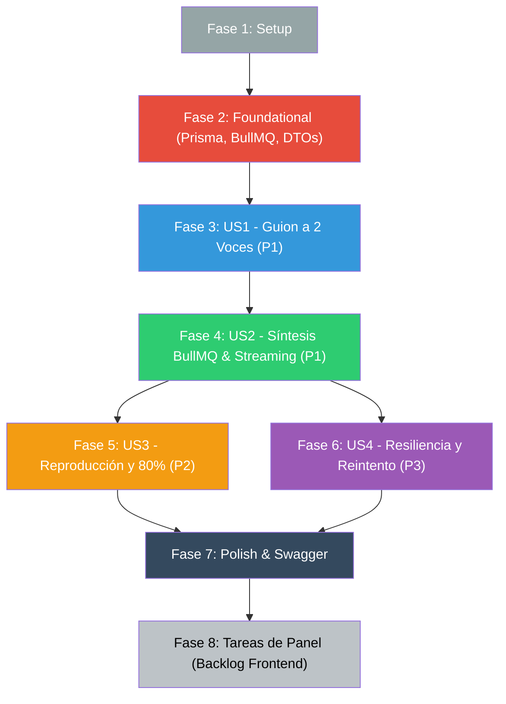

# Tasks: 016 — Pipeline de Audio: Guion a 2 Voces y Síntesis TTS

**Input**: Documentos de diseño en `specs/016-pipeline-audio-guion-tts/`  
**Prerequisites**: [plan.md](./plan.md), [spec.md](./spec.md), [research.md](./research.md), [data-model.md](./data-model.md), [contracts/audio-api.yaml](./contracts/audio-api.yaml), [quickstart.md](./quickstart.md)

**Tests**: Obligatorios para la lógica de síntesis, encolado en BullMQ, streaming con Range y validación temporal del 80% (Principio I, II, IV y CLAUDE.md).

## Format: `[ID] [P?] [Story] Descripción con ruta de archivo`

- **[P]**: Puede ejecutarse en paralelo (archivos distintos, sin dependencias pendientes).
- **[US#]**: A qué historia de usuario pertenece (obligatorio en fases de historias).

## Path Conventions

Backend NestJS en `src/`, schema en `prisma/`, tests `*.spec.ts` junto al código.  
Tareas de frontend al final corresponden al repositorio hermano `trimIA-frontend` (Principio V y Regla de Cierre de Spec).

---

## Phase 1: Setup — Configuración y Línea Base

**Purpose**: Verificar el entorno de desarrollo, contenedores y dependencias antes de introducir cambios.

- [X] T001 Verificar estado del entorno Docker (`docker compose ps`) asegurando conectividad con PostgreSQL y Redis
- [X] T002 Ejecutar suite de pruebas de regresión base (`npm test -- src/training`) asegurando que los tests de las specs 014 y 015 pasen en verde
- [X] T003 Asegurar la existencia del directorio persistente `storage/audio/` para desarrollo en el host y contenedor

---

## Phase 2: Foundational — Modelos de Datos, Storage y Cola BullMQ

**Purpose**: Establecer las entidades de persistencia en Prisma, DTOs y servicios base que bloquean a todas las historias de usuario.

**⚠️ CRÍTICO: Ninguna historia de usuario puede implementarse hasta completar esta fase.**

- [X] T004 Agregar enum `AudioStatus` (`NOT_REQUESTED`, `SCRIPT_GENERATED`, `AUDIO_PENDING`, `AUDIO_GENERATING`, `AUDIO_READY`, `AUDIO_FAILED`) en `prisma/schema.prisma`
- [X] T005 Extender el modelo `Pill` con campos `audioStatus`, `audioScript` (Json), `audioUrl`, `audioDurationSeconds`, `audioError` y `audioGeneratedAt` en `prisma/schema.prisma`
- [X] T006 Extender el modelo `EmployeeProgress` con campos `playbackProgressSeconds`, `isAudioCompleted` y `lastPlaybackReportAt` en `prisma/schema.prisma`
- [X] T007 Aplicar cambios de esquema en PostgreSQL con `npx prisma db push` y regenerar cliente con `npx prisma generate`
- [X] T008 [P] Crear DTOs del guion de audio en `src/training/dto/audio-script.dto.ts` definiendo `SpeakerRole`, `DialogueLineDto`, `AudioScriptDto` y `UpdateAudioScriptDto`
- [X] T009 [P] Crear DTOs de estado de audio en `src/training/dto/audio-status.dto.ts` definiendo `AudioStatusResponseDto`
- [X] T010 [P] Crear DTOs de progreso de reproducción en `src/training/dto/playback-progress.dto.ts` definiendo `ReportPlaybackProgressDto` y `PlaybackProgressResponseDto`
- [X] T011 [P] Implementar el servicio `AudioStorageService` en `src/training/services/audio-storage.service.ts` con métodos `saveAudio`, `getAudioMetadata` y `createAudioStream` con soporte de cabecera HTTP `Range`
- [X] T012 [P] Implementar el servicio `TtsService` en `src/training/services/tts.service.ts` para síntesis multilocutor con cliente Gemini / fallback estructurado
- [X] T013 Registrar la cola BullMQ `'training-audio'` y los nuevos servicios en `src/training/training.module.ts`

**Checkpoint**: Base de datos sincronizada, cola BullMQ registrada y servicios de storage/TTS listos.

---

## Phase 3: User Story 1 — Generación y Edición del Guion a 2 Voces (Priority: P1) 🎯 MVP (Parte 1)

**Goal**: Permitir al supervisor generar automáticamente con IA un guion a dos voces (conductor y copresentador con modismos rioplatenses naturales) a partir del contenido de una píldora aprobada, y poder editar los parlamentos antes de la síntesis.

**Independent Test**: Invocar `POST /training/pills/:id/script` con token de supervisor de Cobranzas; verificar que retorna un diálogo de 2 personajes (`SPEAKER_1` y `SPEAKER_2`) menor a 5 minutos, editarlo con `PUT /training/pills/:id/script`, y consultar la transcripción con `GET /training/pills/:id/script`.

### Implementation for User Story 1

- [X] T014 [US1] En `TrainingService` (`src/training/training.service.ts`), implementar método `generatePillAudioScript(supervisorId: string, pillId: string)` que invoque a Gemini con prompt estructurado para dos locutores y guarde el guion en `Pill.audioScript` con `audioStatus: SCRIPT_GENERATED`
- [X] T015 [US1] En `TrainingService` (`src/training/training.service.ts`), implementar método `updatePillAudioScript(supervisorId: string, pillId: string, dto: UpdateAudioScriptDto)` que valide y guarde las ediciones del supervisor
- [X] T016 [US1] En `TrainingService` (`src/training/training.service.ts`), implementar método `getPillAudioScript(pillId: string)` que retorne el guion estructurado para supervisión y transcripción del empleado
- [X] T017 [US1] En `TrainingSupervisorController` (`src/training/training-supervisor.controller.ts`), implementar endpoints `POST /training/pills/:id/script` y `PUT /training/pills/:id/script` con validación de sector mediante `assertPuedeEscribir` (Principio I)
- [X] T018 [US1] En `TrainingController` (`src/training/training.controller.ts`), implementar endpoint `GET /training/pills/:id/script` decorado con Swagger y `JwtAuthGuard`
- [X] T019 [US1] Crear pruebas unitarias en `src/training/training.service.spec.ts` y controladores para verificar la generación de diálogo a 2 voces, edición de parlamentos y denegación 403 por sector ajeno

**Checkpoint**: El supervisor puede generar y pulir guiones de podcast a dos voces de forma segura.

---

## Phase 4: User Story 2 — Síntesis Asíncrona de Audio TTS y Streaming HTTP (Priority: P1) 🎯 MVP (Parte 2)

**Goal**: Encolar en BullMQ la síntesis de voz del guion aprobado (`POST /training/pills/:id/audio/generate`), procesarla en segundo plano con dos timbres diferenciados, guardar el MP3 en disco persistente y servirlo vía streaming HTTP (`GET /training/pills/:id/audio`) con soporte `Range`.

**Independent Test**: Disparar la generación de audio; verificar que responde `202 Accepted` de inmediato con status `AUDIO_PENDING`, que el worker procesa el audio generando el MP3 en `storage/audio/`, y que una petición con cabecera `Range: bytes=0-1024` responde `206 Partial Content`.

### Implementation for User Story 2

- [X] T020 [US2] Crear el procesador BullMQ `AudioGenerationProcessor` en `src/training/processors/audio-generation.processor.ts` para procesar el job `'generate-audio'`, actualizando a `AUDIO_GENERATING`, invocando `TtsService` y persistiendo el archivo MP3 mediante `AudioStorageService` a `AUDIO_READY`
- [X] T021 [US2] En `TrainingService` (`src/training/training.service.ts`), implementar método `enqueueAudioGeneration(supervisorId: string, pillId: string)` que valide la existencia del guion, verifique sector con `assertPuedeEscribir`, pase el estado a `AUDIO_PENDING` y encole el job en BullMQ
- [X] T022 [US2] En `TrainingSupervisorController` (`src/training/training-supervisor.controller.ts`), implementar endpoint `POST /training/pills/:id/audio/generate` retornando `202 Accepted`
- [X] T023 [US2] En `TrainingController` (`src/training/training.controller.ts`), implementar endpoint de consulta de estado `GET /training/pills/:id/audio/status` y endpoint de streaming `GET /training/pills/:id/audio` con soporte para cabecera `Range` (`206 Partial Content`)
- [X] T024 [US2] Crear pruebas unitarias en `src/training/training.service.spec.ts` para el encolado en BullMQ, procesamiento del worker y respuestas de streaming parcial

**Checkpoint**: Pipeline de audio asíncrono y streaming operativo. MVP completo.

---

## Phase 5: User Story 3 — Reproducción y Desbloqueo Adaptativo al 80% (Priority: P2)

**Goal**: Registrar el avance de reproducción del empleado (`POST /training/pills/:id/playback-progress`), validar que el avance sea continuo y libre de saltos fraudulentos, y marcar la lección como completada en audio (`isAudioCompleted = true`) al alcanzar el 80% del tiempo total.

**Independent Test**: Enviar reportes progresivos de 30s, 60s, hasta superar el 80% de la duración del audio; verificar que el backend devuelve `isAudioCompleted: true` y que saltos repentinos sin tiempo transcurrido son ignorados.

### Implementation for User Story 3

- [X] T025 [US3] En `TrainingService` (`src/training/training.service.ts`), implementar método `recordPlaybackProgress(employeeId: string, pillId: string, currentSeconds: number)` con algoritmo antifraude (comparación con `lastPlaybackReportAt`) y activación de `isAudioCompleted: true` al alcanzar el 80% de `audioDurationSeconds`
- [X] T026 [US3] En `TrainingController` (`src/training/training.controller.ts`), implementar endpoint `POST /training/pills/:id/playback-progress` retornando `PlaybackProgressResponseDto`
- [X] T027 [US3] En `TrainingService` (`src/training/training.service.ts`), actualizar `getEmployeePill` y `getEmployeeModules` para incluir `hasAudio`, `audioStatus`, `audioDurationSeconds` y el progreso de escucha `isAudioCompleted` del empleado
- [X] T028 [US3] Crear pruebas unitarias en `src/training/training.service.spec.ts` para el cálculo de porcentaje, bloqueo de saltos fraudulentos y activación de `isAudioCompleted`

**Checkpoint**: Tracking de audio y desbloqueo al 80% validado.

---

## Phase 6: User Story 4 — Resiliencia ante Fallos y Reintento de Síntesis (Priority: P3)

**Goal**: Garantizar que errores de cuota o timeouts en el modelo de voz sean capturados por el worker, registrando `AUDIO_FAILED` y permitiendo al supervisor reintentar la generación sin perder el guion ni romper la píldora teórica.

**Independent Test**: Simular un error en el proveedor TTS; verificar que la píldora queda en `AUDIO_FAILED` con mensaje de error, y que un nuevo llamado a `POST /training/pills/:id/audio/generate` reencola la tarea limpiamente.

### Implementation for User Story 4

- [X] T029 [US4] En `AudioGenerationProcessor` (`src/training/processors/audio-generation.processor.ts`), capturar excepciones al agotar reintentos de BullMQ, registrando `audioStatus: AUDIO_FAILED` y guardando el mensaje en `Pill.audioError`
- [X] T030 [US4] En `TrainingService` (`src/training/training.service.ts`), permitir que `enqueueAudioGeneration` acepte píldoras en estado `AUDIO_FAILED` para reiniciar el ciclo a `AUDIO_PENDING`
- [X] T031 [US4] Crear pruebas unitarias en `src/training/training.service.spec.ts` simulando fallos de síntesis y reintentos del supervisor

**Checkpoint**: Resiliencia y auto-recuperación de jobs de audio completada.

---

## Phase 7: Polish & Cross-Cutting Concerns

**Purpose**: Documentación Swagger, validación de integración contra quickstart y verificación de calidad.

- [X] T032 [P] Actualizar anotaciones OpenAPI `@ApiTags('Capacitación')`, `@ApiOperation` y `@ApiResponse` en controladores y DTOs de `src/training/`
- [X] T033 Ejecutar y validar los 4 escenarios de integración descritos en `specs/016-pipeline-audio-guion-tts/quickstart.md`
- [X] T034 Correr suite completa de pruebas unitarias (`npm test -- src/training`) asegurando 100% de tests en verde y compilación limpia con `npm run build`

---

## Phase 8: Cierre de Spec — Tareas de Panel (Frontend en `trimIA-frontend`)

**Purpose**: Enumerar las tareas necesarias para ejercitar estos endpoints desde el frontend de pruebas, cumpliendo con la regla constitucional de cierre de spec. *(Estas tareas se enumeran para el backlog del panel y se implementan posteriormente)*.

- [ ] T035 [Panel] Implementar métodos de audio en `api.js` de `trimIA-frontend` (`generateAudioScript`, `updateAudioScript`, `enqueueAudioGeneration`, `getAudioStatus`, `reportPlaybackProgress`)
- [ ] T036 [Panel] Diseñar e implementar modal de revisión y edición del guion a 2 voces para el supervisor (`AudioScriptModal.jsx`) con previsualización de personajes
- [ ] T037 [Panel] Integrar reproductor de podcast en `PillStudyModal.jsx` con controles de reproducción, barra de avance, streaming de audio y visualización del diálogo sincronizado
- [ ] T038 [Panel] Implementar reporte periódico de progreso de reproducción en el reproductor web con indicador de desbloqueo al alcanzar el 80%
- [ ] T039 [Panel] Agregar en `TrainingPanel.jsx` indicador de estado del audio (`AUDIO_GENERATING`, `AUDIO_READY`, `AUDIO_FAILED`) y botón de reintento para supervisores

---

## Dependencies & Execution Order

### Oportunidades de Paralelismo
- **T008, T009, T010, T011, T012**: Creación de DTOs y servicios desacoplados (`AudioStorageService`, `TtsService`) pueden desarrollarse en paralelo tras T007.
- **T032**: Decoradores de Swagger pueden agregarse en paralelo una vez definidos los controladores.

---

## Resumen de Tareas

- **Total de tareas**: 39 tareas (34 tareas de backend ejecutables + 5 tareas de panel para backlog de frontend).
- **Alcance MVP**: Fases 1 a 4 (Setup, Modelos, Guion a 2 voces y Síntesis asíncrona con Streaming).
